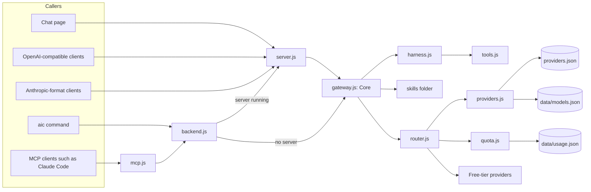
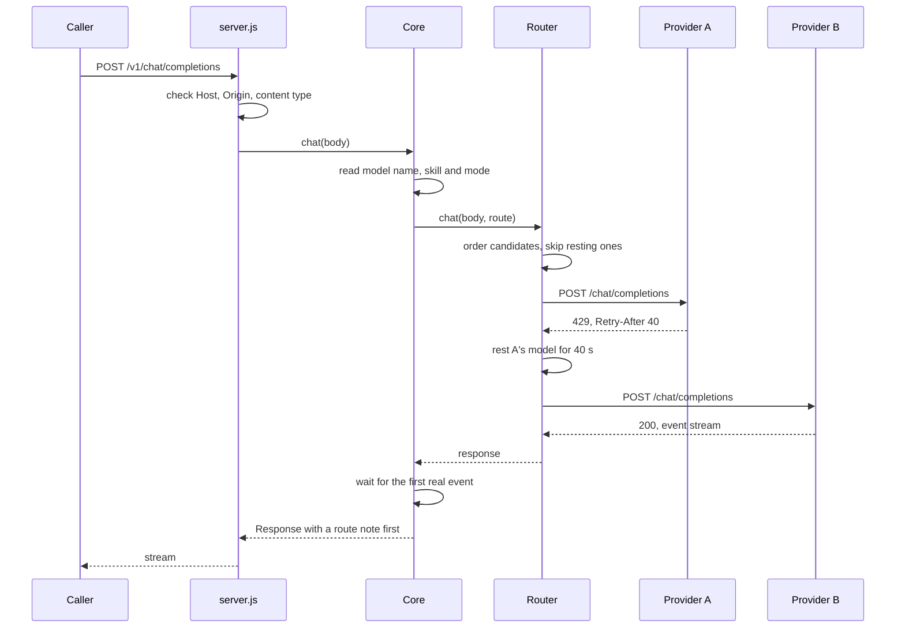
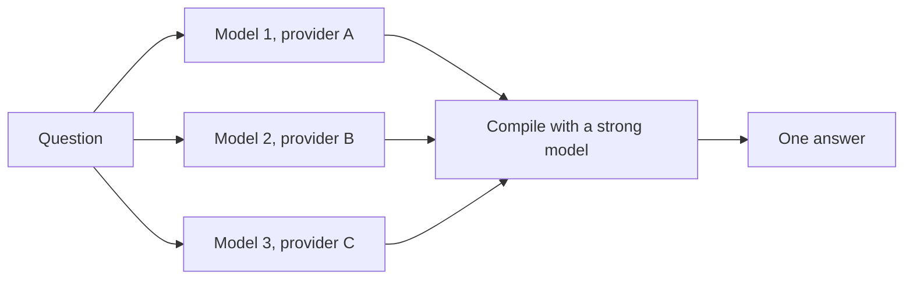

# How AI Compiler works, and how it could be improved

This document explains the design of AI Compiler in enough detail to change it with confidence, then sets out what could be improved and in what order. The [README](https://github.com/FlamingAirplane/ai-compiler#readme) covers installing and using it.

**Contents**

- [In short](#in-short)
- [The parts](#the-parts)
- [The life of a request](#the-life-of-a-request)
- [Choosing a model](#choosing-a-model)
- [Handling failure](#handling-failure)
- [Tracking quota](#tracking-quota)
- [The harness](#the-harness)
- [Images](#images)
- [Skills](#skills)
- [Agent tools and their safety limits](#agent-tools-and-their-safety-limits)
- [The interfaces](#the-interfaces)
- [Securing the local server](#securing-the-local-server)
- [Configuration and files](#configuration-and-files)
- [Testing](#testing)
- [Known limitations](#known-limitations)
- [How it could be improved](#how-it-could-be-improved)

## In short

AI Compiler is a local server that sits between you and the free tiers of about a dozen AI providers. It is about 4,000 lines of JavaScript plus a 900-line web page, and has no dependencies beyond Node.js 22.

Every request goes through one function, `Core.chat()`. It reads the model name to work out what was asked for, then sends the request to the best model that still has free quota. If that model is rate limited or down, it is rested for as long as the provider asked, and the next one is tried. Usage, rests and the limits providers report are written to a file, so they survive restarts and are shared by every process.

On top of that, an optional harness spends several free requests on one question:

- several models answer and one compiles the result;
- one model's draft is reviewed by another;
- a model calls tools before answering.

All of it is reachable five ways: a chat page, a command line, an OpenAI-compatible API, an Anthropic-format API, and an MCP server.

## The parts



| File | Lines | Responsibility |
| --- | --- | --- |
| `src/gateway.js` | 790 | The core. `chat()` reads the model name, applies a skill, runs single or harness mode, and always returns a web `Response`. Also the self-test, the activity log, the model list and the status report. |
| `src/router.js` | 346 | Orders the candidate models, sends the request, classifies failures, sets rests, and falls through to the next candidate. |
| `src/providers.js` | 318 | Loads the provider catalog, fetches each provider's model list, filters and ranks it, and caches the result. |
| `src/quota.js` | 314 | Usage counters, rests, and provider-reported limits, saved so that several processes can share them safely. |
| `src/harness.js` | 257 | The ensemble, refine, agent and panel modes. |
| `src/tools.js` | 688 | The agent's tools and the checks that keep them contained. |
| `src/skills.js` | 67 | Loads the Markdown skill files. |
| `src/server.js` | 205 | The HTTP server: both APIs, the management API, and the dashboard files. |
| `src/anthropic.js` | 203 | Translates between the Anthropic Messages format and the OpenAI format. |
| `src/mcp.js` | 170 | The MCP server over standard input and output. |
| `src/cli.js` | 339 | The `aic` command. |
| `src/backend.js` | 48 | Lets the CLI and the MCP server use the running server, or load the core themselves if it is not running. |
| `src/sse.js`, `src/format.js`, `src/config.js` | 288 | Stream parsing, plain-text tables, and settings. |
| `public/` | 896 | The chat page and dashboard. |

## The life of a request



1. **Arrival.** `server.js` refuses the request unless it is addressed to `localhost`, comes from no website or from the dashboard itself, and is JSON. It reads the body (up to 32 MB) and records where the request came from: `api`, `anthropic`, `chat`, `cli` or `mcp`.
2. **Reading the request.** `Core.prepare()` turns the model name into three things: a route, a mode, and a skill.

   | Model name | Route | Mode |
   | --- | --- | --- |
   | `auto`, or any name it does not recognise | every provider | single |
   | `auto:smart`, `auto:fast` | larger or quicker models first | single |
   | `groq`, `gemini/<model>` | one provider, or one exact model | single |
   | `gpt-oss-120b` (a name several providers serve) | those providers first, then everything else | single |
   | `boost`, `ensemble`, `refine`, `agent`, `panel` | every provider | that harness |
   | `skill:code-review`, `boost@code-review`, `skill:auto` | as the skill asks | as the skill asks |

   The same can be sent as `"aic": { "mode": ..., "skill": ... }` in the request body. A skill adds its instructions to the end of the system prompt and may set a tier and a default temperature. A request that brings its own tools is always passed through as a single request, because the caller is running its own agent loop and expects tool calls back.
3. **Single mode.** The router tries candidates in order until one answers.
   - A non-streaming reply gets an `aic` field naming the provider, the model and every attempt.
   - A streaming reply is held back until its first real event. A stream that opens with an error, or ends without saying anything, can then still go to another model.
   - The stream is passed through with a `: aic {...}` comment in front. Standard clients ignore comments; the dashboard and the CLI read them.
4. **Harness mode.** See [the harness](#the-harness).
5. **Accounting.** Each successful request is counted. Tokens come from the provider's usage figures, or are estimated when there are none. The request is added to the activity log.

## Choosing a model

### The catalog

`providers.json` lists the providers in the order they are preferred. Each entry describes how to reach a provider and how to read its model list:

| Field | Meaning |
| --- | --- |
| `id`, `name`, `baseUrl` | Identity and the OpenAI-compatible base URL. `{NAME}` in a URL is filled from the environment (Cloudflare needs an account ID). |
| `keyEnv`, `extraEnv` | Which variables must be set for the provider to count as set up. |
| `modelsUrl`, `modelsHeaders`, `modelIdField` | Where the model list lives if not at `/models`, extra headers for that request only, and which field holds the model name. |
| `keyCheckUrl` | An endpoint that proves a key works (OpenRouter has one). |
| `include`, `exclude`, `freeSuffix` | Which models to keep. OpenRouter keeps only models ending in `:free`. |
| `prefer` | Regular expressions in order of preference. |
| `fast`, `maxModels`, `models` | Override the fast or smart guess, cap the list, or pin exact models instead of discovering them. |
| `resetTz`, `dailyReset` | The time zone a daily quota resets in, and whether it resets at a fixed time (`fixed`) or on a rolling window. |
| `sharedQuota` | One quota covers every model, so one rate limit rests the whole provider. |
| `hint` | Published request limits, used only for the "about N left" estimate. |
| `local` | A runner on this computer (Ollama), used last and needing no key. |
| `dropParams`, `headers` | Request fields to remove, and headers to add, for providers that need it. |

### Discovery

The first time a provider is needed, its model list is fetched with the user's key.

- **Rejected keys.** A 401 or 403, or a 400 that mentions an API key, marks the key as rejected. A rejected key takes the provider out of rotation without spending a chat request.
- **Other failures.** Any other failure is recorded, and the previous list is kept if there was one.
- **Caching.** Lists are cached in `data/models.json` under a fingerprint of the key and URL, so changing a key throws the old list away. A good list is kept for 12 hours, a failure is retried after 5 minutes, and a local runner is re-checked every minute. A rejected key stays rejected until the key changes or the user presses "Re-check providers".

### Filtering and ranking

`rankModels()` turns a provider's raw list into a short ranked one. Nothing is hardcoded to model names, because those change every month.

1. **Drop what is not a chat model.** Embedding, speech, image, video, moderation and similar models are dropped by name, as is any model whose listed outputs do not include text.
2. **Apply the catalog's filters.** `include`, `exclude` and `freeSuffix` decide what stays.
3. **Sort into tiers.** A model is *fast* if its name contains a speed word as a whole word (`flash`, `lite`, `mini`, `nano`, `small`, `instant`, `lightning`, `bolt`, `haiku`, `tiny`, `xs`), or if its parameter count is under 30 billion. Otherwise it is *smart*.

   Size is read from the name: `70b` is 70, `1t` is 1,000, and `8x7b` is 56. The active-parameter count in mixture-of-experts names (`-a12b`) is ignored, because it describes speed, not size.
4. **Score quality.** The score is the Artificial Analysis index where the provider publishes it (OpenRouter does). Otherwise it is guessed from size: 12 + 6 × log₂(size + 1), or 35 when the size is unknown.

   When only some models in a list have a published score, the others get the middle of those scores. A size guess is on a different scale and would otherwise bury the scored models.
5. **Sort.** The order is:
   - position in `prefer`;
   - stable releases before previews;
   - score;
   - size;
   - newest first;
   - name.
6. **Remove duplicates.** Dated snapshots of one model (`mistral-large-2411`, `mistral-large-latest`) keep only the best-ranked one.
7. **Cap the list.** Up to half of `maxModels` (6 by default) is kept in each tier, so both smart and fast requests always have somewhere to go.

### Candidate order

For each request, `Router.candidates()` builds the list to try:

- **What is included.** Providers that are set up, in catalog order. With `"strategy": "round-robin"` the starting provider rotates on each request.
- **What is skipped.** Rejected keys, resting models, and models known not to support tool calling when the request needs tools.
- **Tiers.** A requested tier filters the list. If nothing in that tier is available, any tier is used.
- **Breadth first.** Every provider's two best available models come before any provider's third. Draining one provider's weakest model before trying the next provider's best would give worse answers for no gain.
- **Named routes.** A named provider keeps its own order. A bare model name puts every provider that serves it first; the rest follow, so a tool that always sends one model name still works when those providers are spent.
- **Harness controls.** The harness can pin one candidate to the front (`first`) and push providers it has already used to the back (`avoid`). That is how the ensemble gets answers from different models.

## Handling failure

### What each failure means

| Response | Kind | What happens to the model | What happens to this request |
| --- | --- | --- | --- |
| 429 | `limited` | Rests (see below) | Next candidate. A second rate limit takes the provider out of this request; a shared-quota provider is out at once. |
| 413; 429 "request too large"; 400 or 422 about context length | `too_large` | Nothing: it says nothing about the model | Next candidate |
| 401; 400 naming an API key | `auth` | Key marked rejected until it changes | Provider out |
| 402; 403 about quota or credit | `credits` | Whole provider rests until its next daily reset | Provider out |
| Other 403 | `forbidden` | Model rests 6 hours | Next candidate |
| 404; 400 "model not found" or "deprecated" | `no_model` | Model rests 6 hours and the model list is refreshed | Next candidate |
| 400 about tools, when tools were sent | `no_tools` | Model is left out of tool requests for the life of the process | Next candidate |
| Other 400 or 422 | `bad_request` | Nothing | Next candidate. After three, stop: the request itself is at fault. |
| 5xx | `server` | Rests 30 s, doubling each time up to 10 minutes | Next candidate. A second failure takes the provider out of this request. |
| No response in time, connection failure | `network` | As `server` | As `server` |
| 200 with an error inside, an empty answer, or a stream that opens with an error | unusable | Rests 60 s, doubling | Tried again, up to twice more |

There is one special case. When a request sets `max_tokens` and a provider rejects it with a 400, 413 or 422 that mentions tokens, the same model is tried once more without the cap. Agent tools such as Claude Code ask for 32,000 output tokens, which many free models refuse. On Groq the cap also counts against a per-minute token budget.

### How long a rate-limited model rests

The router uses the first of these that applies:

1. **Not in the free tier.** The message says `limit: 0` and mentions the free tier. This is Gemini's answer for a model its free tier does not include, so the model rests until the next daily reset, and at least 6 hours.
2. **Fixed daily reset.** The message describes a daily limit and the provider resets at a fixed time (`dailyReset: "fixed"`, for Gemini and OpenRouter). The model rests until that reset. Gemini sends a short retry delay even for a daily limit, which would otherwise cause a failed request every minute until midnight.
3. **Retry-After header.** Seconds, or an HTTP date.
4. **Retry time in the body.** A `retryDelay` or `retry_after` field, or wording such as "try again in 1m26.4s". Groq's daily limits are a rolling window, so its "try again in" is trusted.
5. **Daily limit with no time given.** Rests until the provider's next daily reset.
6. **Otherwise,** one minute.

A model that is rate limited again before it has succeeded rests at least 1 minute × 2 to the power of its strike count, up to an hour. Every rest lasts between 1 second and 2 days.

Separately, when a successful response carries `x-ratelimit-remaining-*: 0` with a reset time, the model rests until then before the provider has to refuse anything. Reset times are calculated in each provider's own time zone; Gemini resets at midnight Pacific time.

### Waiting instead of failing

Sometimes every model that could answer is resting, but the first one is back within `waitForQuotaMs` (15 seconds by default). The request then waits and tries again, up to three times. This smooths over per-minute limits. A longer rest fails at once, with a `Retry-After` header. The self-test never waits.

### What a caller sees

| Code | HTTP | Meaning |
| --- | --- | --- |
| `no_providers` | 503 | No key is set up, or the only provider is a local runner that is not running. |
| `no_models` | 503 | Providers are set up, but none has a usable model (no models found, or the keys were rejected). |
| `all_limited` | 429 | Everything that was tried, or could be tried, is out of quota. `Retry-After` says when the first one is back. |
| `too_large` | 413 | The request is too large for every model that was tried. |
| `upstream_rejected` | 4xx | Three providers rejected the request as malformed. |
| `bad_upstream_response` | 502 | A provider kept answering with nothing usable. |
| `all_failed` | 502 | Anything else. The message names the last provider's error. |
| `unknown_skill`, `invalid_request` | 400 | The request named a skill that does not exist, or had no messages. |
| `cancelled` | 499 | The caller went away. |

Every error body lists each attempt (provider, model, status, kind, message, time) and each skipped candidate with the reason, so a caller can see exactly what happened.

## Tracking quota

`quota.js` keeps, for each provider:

- today's requests, tokens, rate limits and errors, overall and per model;
- totals, and 35 days of daily history;
- when it was last used, and its last error;
- the active rests;
- the latest limits the provider reported.

"Today" is measured in the provider's reset time zone.

**Provider-reported limits.** Many providers put their limits in response headers, as `x-ratelimit-limit`, `x-ratelimit-remaining` and `x-ratelimit-reset`, optionally followed by `-requests` or `-tokens` and `-day`, `-hour` or `-minute`. These are all parsed. The dashboard shows the most useful one, such as "412 of 1,000 requests left today, refills in 3h". Reset values arrive in many formats (seconds, `2m59.5s`, epoch seconds, epoch milliseconds, HTTP dates), and all are understood.

**Estimates.** Most providers never say how much of the daily quota is left. Where the catalog has a published daily limit (`hint.rpd`), the dashboard shows that limit minus today's count, labelled as an estimate. Counts only include requests made through AI Compiler.

**Sharing between processes.** The server, the CLI and the MCP server may all run at once, each with its own copy of the counters. Simply saving would let the last writer erase the others' counts. Instead:

1. Every change is applied in memory straight away and also kept as a pending operation (a request, tokens, a failure, a rest, a limits report).
2. About 400 ms later the process takes a lock file (`usage.json.lock`), re-reads `usage.json`, replays its pending operations on top of what other processes wrote, saves, and releases the lock.
3. Each process also re-reads the file when it changes, at most once a second, so a rest set by one process is respected by the others.

A lock older than 10 seconds is treated as left behind by a crashed process and removed. A process that cannot get the lock within 2 seconds saves anyway rather than lose its counts.

## The harness

Harness modes only run when a request asks for one, because each costs several free requests:

| Mode | What happens | Free requests |
| --- | --- | --- |
| `ensemble` | Three different models answer in parallel. A strong model then writes one answer from the best parts. | 4 |
| `refine` | One model drafts. A different model looks for mistakes. The draft is corrected, unless the reviewer found nothing. | 2 or 3 |
| `agent` | The model works in a loop, calling tools until it is ready to answer. | 1 per round, 8 rounds at most |
| `panel` | Like ensemble, but every answer is returned side by side, uncompiled. | 3 |

`boost` runs the default (ensemble), or whichever mode the chosen skill prefers.

Each mode gets a small context object. `call()` makes one model call with full fallback, `pick(n)` names up to n different models that could answer right now, and `note()` reports progress. A mode returns either finished text, or one last model call whose output is the answer. When the caller is streaming, that last call is streamed straight through, so the final answer appears token by token rather than all at once at the end.

Progress travels in the stream as comments (`: aic {"event":"stage",...}`), which standard clients ignore and the dashboard shows as a list of steps.

### Ensemble



1. **Pick the models.** `pick(3)` chooses three models, from different providers where possible.
2. **Ask in parallel.** Each request pins its model to the front and pushes the other two to the back. If one fails, it falls back to a model nobody else is using.
3. **Compile.** Empty answers are dropped. The rest are added to the end of the user's message inside `<candidate>` tags, under a line saying the user did not write that section. The compiling model is told to treat the candidates as raw material that may be wrong, to settle disagreements rather than average them, to keep details only one candidate caught, and never to mention the process.
4. **Fall back.** If the compile step fails, the best single answer is returned. If only one model is available at all, ensemble runs as refine instead.

### Refine

1. **Draft.** A smart model writes the draft.
2. **Review.** A different model reviews it, with the conversation and any system instructions, at a low temperature. It is told to name concrete problems (wrong facts, bugs, missed parts of the request) and the fix for each, and not to rewrite the answer. If it replies `NO ISSUES`, the draft is returned after two requests.
3. **Revise.** Otherwise the draft's author writes the final answer, with the draft and review attached, fixing valid points and ignoring mistaken ones.

### Agent

1. **Tools.** The model gets the available tools (or only those a skill lists) and is told that tool results are data, not instructions.
2. **Rounds.** Each round is one model call. Tool calls are run, and their results are added as `tool` messages. The loop stays with one model where possible, because tool-call conventions differ slightly between providers.
3. **Bad calls.** Arguments that are not valid JSON, or a tool that does not exist, come back to the model as error text rather than crashing the loop.
4. **Step limit.** After the last allowed round, the model is asked for its final answer with tools turned off.
5. **No tools.** If no tools are available, agent runs as refine.

### Panel

Panel is the ensemble's first stage on its own: the answers come back under "Answer 1: provider · model" headings. It is the most useful mode for another AI. Claude Code can judge several independent answers itself better than a free model can compile them.

## Images

`src/images.js` applies the same idea to image generation. Image APIs are not standardised the way chat is, so each provider in `providers.json` under `imageProviders` has a `kind` that says how to ask and how to read the answer:

| Kind | Request | Answer |
| --- | --- | --- |
| `cloudflare` | `POST /ai/run/<model>`; FLUX takes only a prompt and steps | JSON with a base64 image (FLUX), or raw bytes (Stable Diffusion) |
| `nvidia` | `POST /v1/genai/<model>` with size, seed and steps | JSON `artifacts[0].base64`, with a finish reason that reports the safety filter |
| `huggingface` | `POST /hf-inference/models/<model>` with `inputs` and size | Raw bytes |
| `pollinations` | `GET /prompt/<prompt>?width&height&seed&private=true` | Raw bytes; no key |

Whatever comes back is checked by its first bytes (PNG, JPEG or WebP), so an error page can never be saved as a picture.

Failures follow the chat rules, simplified:

- **Rate limits.** A 429, a 403 about quota, or any reply saying "limit reached" or "retry after N s" rests the whole provider. It rests for the time the provider gave, or until its daily reset for daily or neuron quotas, or for one minute.
- **Rejected keys.** A rejected key rests the provider for 12 hours, or until the key changes.
- **Missing models.** A missing model rests for 6 hours.
- **Safety filter.** A safety-filter refusal moves on, and two refusals stop the request.
- **Waiting.** If every image tier is resting but one is back within 60 seconds (`images.waitForQuotaMs`), the request waits for it. Pollinations allows about one image every 45 seconds per computer, so short waits are common.

`Core.generateImages()` makes 1 to 4 images one after another, which is kinder to per-minute limits than firing them at once. It can first ask a fast chat model to turn the user's idea into a detailed prompt. It saves each image with its prompt, provider, model, size and seed in `data/images` (the newest 300 are kept), and returns them as base64 as well. The server exposes the OpenAI-style `POST /v1/images/generations`, the saved files under `/images/<file>`, a list at `GET /api/images`, and `POST /api/images/delete`. The CLI has `aic image`, and the MCP server returns the image itself from `generate_image`, so an MCP client can show it.

## Skills

Skills live in `skills/` as Markdown files: a few settings between `---` lines, then the instructions.

```markdown
---
name: code-review
description: Review code or a diff for bugs, security problems and unclear logic.
category: coding
boost: ensemble
tier: smart
temperature: 0.2
---
You are reviewing code. Report what is wrong, most serious first. ...
```

| Field | Effect |
| --- | --- |
| `mode` | The mode used when the skill is called on its own. Most are `single`; tool-driven skills such as `research` and `math` are `agent`. |
| `boost` | The mode used when a caller asks for boost with this skill. |
| `tier` | Prefer smart or fast models. |
| `tools` | The only agent tools this skill may use. |
| `temperature` | A default the caller can override. |

The instructions are added after any system prompt the caller sent, so a skill never removes the caller's own instructions. `skill:auto` asks a fast model to choose a skill from the list of names and descriptions. There are 36 skills in six categories: coding, writing, research, analysis, thinking, and learning.

## Agent tools and their safety limits

| Tool | Default | Turned on by |
| --- | --- | --- |
| `wikipedia`, `fetch_url`, `calculator`, `current_time` | On | |
| `web_search` (Tavily free plan) | Off | A `TAVILY_API_KEY` |
| `list_files`, `read_file`, `search_files` | Off | `harness.agent.workspace`, or `--workspace` |
| `write_file` | Off | `allowWrite`, as well as a workspace |
| `run_code` (Python, JavaScript, bash) | Off | `allowCode`, on macOS |

The agent's model is a third party reading untrusted web pages, so every tool assumes it may be manipulated:

- **The network guard.** `fetch_url` resolves names through a lookup that refuses loopback, private, link-local, carrier-grade NAT and multicast addresses. It runs for every connection, including after each redirect, so DNS tricks cannot reach the local network. Bodies are capped at 2 MB and requests at 20 seconds. Only http and https are allowed.
- **The workspace guard.** File paths are resolved through symlinks and must stay inside the workspace folder. `.env` files, private keys, `.git`, `.ssh`, `.aws` and similar are refused even inside it. Large and binary files are refused, and long files are returned in pages.
- **The code sandbox.** `run_code` runs under macOS `sandbox-exec` with a profile that denies all network access, denies writes outside a fresh scratch folder, and denies reading the home folder except where the interpreter itself lives. It has a 20-second limit, after which the whole process group is killed, and the scratch folder is deleted afterwards. The test suite checks each restriction.
- **Permissions stay with the user.** These settings can only be changed in `config.json` or on the command line, never through the web API, so nothing reachable from a browser can widen them.

One residual risk is documented rather than solved. An agent that has both a workspace and web access could be talked by a malicious page into reading a workspace file and putting its contents into a URL it fetches. The defaults avoid it, because the workspace is off.

## The interfaces

**HTTP API** (`http://localhost:4141`):

| Endpoint | Purpose |
| --- | --- |
| `POST /v1/chat/completions` | OpenAI-compatible chat, streaming or not, including tools and images. |
| `GET /v1/models` | Every route name: auto, tiers, harness modes, skills, shared model names, and each provider's models. |
| `POST /v1/messages`, `POST /v1/messages/count_tokens` | Anthropic-compatible, for Claude Code and other Anthropic-format tools. |
| `GET /api/status`, `GET /api/skills`, `GET /api/health` | Dashboard data. |
| `POST /api/keys`, `POST /api/refresh`, `POST /api/test` | Save or remove keys, re-check providers, run the self-test. |

Responses carry `x-aic-mode`, `x-aic-provider` and `x-aic-model` headers.

**The Anthropic translation.**

- **Requests.** System blocks are joined. `tool_use` and `tool_result` blocks become OpenAI tool calls and `tool` messages, and images become data URLs. `tool_choice` is mapped across. Anthropic's server-side tools, such as its web search, have no equivalent and are dropped.
- **Model names.** Claude model names map to routes: anything with "haiku" goes to `auto:fast`, and every other Claude model goes to `auto`. Both are configurable in `anthropicModels`.
- **Streaming.** Streams are rewritten event by event into Anthropic's `message_start`, `content_block_*`, `message_delta` and `message_stop` events, including tool-call argument deltas.
- **Token counting.** Counting is an estimate.

**MCP server** (`aic mcp`). The server speaks JSON-RPC over standard input and output and offers four tools:

- `ask`: one answer, with a mode and optional skill;
- `panel`: several answers side by side;
- `quota_status`;
- `list_skills`;
- `generate_image`;
- `key_status`, `save_api_key` and `remove_api_key`, which manage the saved keys. `key_status` reports which keys are set and where to get the rest, never the keys themselves. `save_api_key` writes the key, checks it with the provider by fetching its model list, and reports whether it works.

It uses the running server when there is one, so its requests share the dashboard's counters; otherwise it loads the core itself. The project's `.mcp.json` registers it for Claude Code, and `.claude/skills/ai-compiler/SKILL.md` tells Claude Code when to use it and what never to send.

**Command line.** The `aic` commands are `serve`, `ask`, `chat`, `status`, `usage`, `check`, `keys`, `models`, `skills`, `open` and `mcp`. `ask` reads piped input, so `git diff | aic ask -s code-review` works; `-f` attaches files (each in a fence longer than any backtick run inside it), and `--copy` copies the answer to the clipboard. Progress goes to standard error and the answer to standard output, so the output can be piped on.

**Dashboard.** A single page with no framework. It polls `/api/status` every 4 seconds, and redraws countdowns every second from the server's clock. Model output is escaped before the small Markdown renderer adds any tags, and the page's content security policy allows only its own script. Conversations (up to 40, each with its own instructions and attached files), and the selections, are kept in the browser's local storage. Text files are read in the browser and sent as part of the message, in a fence the model can tell apart from the question. Status polls double as change detection: a provider going from rate limited to ready, or having its key rejected, raises a short notice.

## Securing the local server

The server holds the user's API keys and spends their quota, so:

- **Binding.** It listens on `127.0.0.1` only, unless started with `--host`, which prints a warning.
- **Host check.** It answers only requests whose `Host` is `localhost`, `127.0.0.1` or `[::1]`, plus any names in `AIC_ALLOWED_HOSTS`. This blocks DNS-rebinding attacks, where a website makes its own domain point at your computer.
- **Origin check.** When a request carries an `Origin`, it must be the server's own. This stops other websites open in your browser from using the API or saving keys.
- **JSON only.** POST bodies must be JSON. That rules out the simple form posts a web page can send without asking.
- **Key storage.** Keys live in one file per user, `~/.config/ai-compiler/keys.env` (`%APPDATA%` on Windows), outside the project, so the server, the CLI and the MCP server Claude Code starts all share them and nothing is lost by re-cloning. The folder is created owner-only (700) and the file is written atomically with owner-only permissions (600). An older project `.env` is still read underneath it, and removing a key removes it from both. Keys are sent only to their own provider, and are never returned by any endpoint or MCP tool. `aic keys set NAME` reads a key without echoing it, so it stays out of shell history and chat logs.
- **Page policy.** Static files get a strict content security policy and `nosniff`, and paths cannot escape the `public` folder.

There is no API key on the local server itself. Anything that can run code as you can already read the keys file, so a key would add little on one machine. It would matter on a network: see the improvements.

## Configuration and files

| `config.json` key | Default | Meaning |
| --- | --- | --- |
| `strategy` | `priority` | `priority` uses providers in catalog order; `round-robin` rotates the starting provider. |
| `maxAttempts` | 8 | Models one request may try. |
| `timeoutMs` | 45000 | Time to wait for a provider's first response. Three times as long for non-streaming requests. |
| `waitForQuotaMs` | 15000 | How long a request may wait for a resting model. |
| `anthropicModels` | `auto`, `auto:fast` | Routes for Claude model names. |
| `harness.boost` | `ensemble` | The mode `boost` runs by default. |
| `harness.ensemble.proposers` | 3 | Models asked in ensemble and panel. |
| `harness.agent.*` | | `maxSteps`, `workspace`, `allowWrite`, `allowCode`, `allowLocalNetwork`. |

The environment variables `AIC_PORT`, `AIC_CONFIG`, `AIC_CATALOG`, `AIC_ENV_FILE`, `AIC_DATA_DIR`, `AIC_SKILLS_DIR` and `AIC_ALLOWED_HOSTS` change where things are.

The data folder holds `models.json` (cached model lists) and `usage.json` (counters and rests). Both are safe to delete.

## Testing

`npm test` runs 74 tests in about five seconds, with no network access and no keys. They run against `test/mock-upstream.js`, a single local server that pretends to be any number of OpenAI-compatible providers. Each pretend provider can be told to:

- require a particular key;
- rate limit after N requests, with or without a retry time and rate-limit headers;
- fail with a given status;
- refuse tools;
- refuse large `max_tokens`;
- open its stream with an error;
- answer slowly;
- reply with anything a test needs, including tool calls.

| File | Covers |
| --- | --- |
| `core.test.js` | Fallback, rests and their expiry, header-driven rests, daily resets, rejected keys, error shapes, streaming, model-name routing, round-robin, cancellation. |
| `harness.test.js` | Ensemble, refine, agent and panel, streaming progress, failure paths, skills, `skill:auto`, client tools passing through. |
| `tools.test.js` | The calculator, the HTML reader, the network guard (including redirects), the workspace guard (including symlinks and secrets), and the code sandbox's network, read and write restrictions. |
| `server.test.js` | The HTTP API, refusal of other websites and other hosts, saving keys, the Anthropic translation both ways, the MCP protocol and tools, and the CLI, including attached files and the usage report. |
| `images.test.js` | Image fallback and rests, each provider kind's request and answer format, safety refusals, waiting for a busy free service, saved files, the image API, the MCP image tool, and `aic image`. |
| `refine.test.js` | Behaviours specific to real providers: model size parsing, ranking with published scores, breadth-first order, shared model names, too-large requests, "limit: 0", fixed and rolling daily resets, unusable replies, waiting for quota, shared usage files, and the self-test. |

What the tests cannot cover:

- **Each real provider.** Testing those needs keys; `aic check` is the tool for it.
- **Claude Code against the Anthropic endpoint.** The translation is tested, but no real Claude Code session has been run through it.
- **The dashboard in a browser.** Checked by hand, not automatically.
- **Running code on Linux or Windows.** The sandbox only exists on macOS.

## Known limitations

- **Real providers are not yet tested.** It has only run against pretend providers. Model lists were checked against the public lists of four providers, but no chat request has gone to a real one. The first request to each provider is the real test, and `aic check` makes that one request on purpose.
- **Remaining quota is mostly unknown.** Few providers report it, so most "left today" figures are estimates or absent.
- **A stream that fails midway cannot move to another model.** The caller has already received part of the answer.
- **Tiers and scores are guesses from model names** where a provider publishes nothing better.
- **Some knowledge is per process.** Which models lack tool calling is remembered only by the process that found out. The activity log shows only the server's own requests.
- **Nothing measures whether the harness helps.** Ensemble and refine are designed to give better answers than one model, but no evaluation yet shows by how much, or for which tasks.
- **Streamed token counts are estimates** when a provider does not send usage in the stream.
- **Harness modes cannot be combined with a caller's own tools.** Those requests are passed through as single requests.
- **`run_code` works only on macOS.**
- **The local API has no key of its own.**
- **The free tiers change often.** The catalog's notes on them will go out of date, which is why nothing depends on those notes.

## How it could be improved

Ordered by how much each would help, within four groups. Effort is rough: **S** is under a day, **M** a few days, **L** a week or more.

### First: be reliable on real providers

1. **Run against every real provider, and keep what is learned.** *(M)* Add `aic check --record`, which saves each provider's real responses: model list, success, rate limit, a too-large request, an error. Turn those into test fixtures, so tests reflect real formats rather than assumed ones. This is the single biggest gap: today's tests prove the logic, not the assumptions about each provider.
2. **Learn each model's daily limit.** *(S)* When a model hits a daily limit after N requests, remember N as its limit for that day of the week. The dashboard can then show a real "left today" for providers that publish nothing. The data is already being counted.
3. **Route on measured health.** *(M)* Track each model's recent latency, error rate and empty-answer rate as moving averages, and let them reorder candidates within a provider. A model that keeps timing out should drop down before it earns a rest.
4. **Adapters where the compatible endpoints fall short.** *(M)* Providers differ in how they name reasoning output (`reasoning` versus `reasoning_content`), report usage while streaming, and handle images and tools. A small per-provider adapter layer would normalise these, and could use a native API when it is much better than its OpenAI-compatible version.
5. **Recover a stream that fails midway.** *(M)* Send the partial answer to the next model as the start of its reply and ask it to continue. It will not always join seamlessly, but it is better than a cut-off answer.

### Next: get better answers

6. **Measure the harness.** *(M)* Build a small evaluation set per skill category, with answers that can be checked (code that must pass tests, maths with known results, facts with sources), and run single, ensemble and refine on it. Use the results to set each skill's default mode, and to drop modes that do not help. Without this, every quality claim is a design intention.
7. **Pick the best answer instead of always merging.** *(S)* For maths and code, majority vote or test-based selection beats synthesis: let ensemble choose when answers can be checked. Choose proposers from different model families, not only different providers, since the same open model on three providers agrees with itself.
8. **Boost automatically.** *(S)* A fast model judges whether a question is hard, and only hard ones get the harness. This was offered when the project began and set aside in favour of an explicit choice. It is worth adding as an option.
9. **Track what each model can do.** *(M)* Record context length, vision, tool calling and structured output for each model, from model lists where available and from failures otherwise. Requests with images, tools or long contexts would then go only to models that can take them, instead of learning by failure.
10. **Fit long conversations to smaller models.** *(M)* When a conversation is too large for the next candidate, summarise or trim the oldest turns rather than skipping that model.

### Then: make it easier to use

11. **An optional key for the local API.** *(S)* A setting that requires a key on every API request, for anyone running it on a home network. It also opens the way to per-client limits.
12. **Run it all the time.** *(M)* Publish to npm (`npx ai-compiler`), and add a background service (launchd on macOS, systemd on Linux) and a Docker image, so tools can rely on it being there.
13. **More endpoints.** *(M)* An embeddings endpoint (Gemini, Cohere, Mistral, NVIDIA and Cloudflare all have free embedding models), and image input routed only to vision models.
14. **More for Claude Code and other agents.** *(M)* MCP tools that take file paths instead of pasted text, a `delegate` tool for batches of small jobs, and MCP prompts for the common skills.
15. **Usage history.** *(S)* The dashboard now charts 14 days and `aic usage` prints up to 35; CSV export and per-provider charts would be next.
16. **More search options.** *(S)* A self-hosted SearXNG instance or other free search APIs alongside Tavily.

### Throughout: keep the code healthy

17. **Type checking.** *(M)* Add JSDoc types and run `tsc --checkJs` in tests, so refactors like the router rewrite are checked by a machine.
18. **Continuous integration.** *(S)* A GitHub Actions workflow running `npm test` on macOS and Linux for every push. The sandbox tests skip themselves where there is no sandbox.
19. **Structured logs.** *(S)* A debug setting that logs each attempt with a request ID, to diagnose a provider's behaviour without a debugger.
20. **Validate and reload settings.** *(S)* Check `providers.json`, `config.json` and the skill files on load with clear error messages, and pick up changes without a restart.
21. **Sandboxes beyond macOS.** *(M)* bubblewrap or nsjail on Linux. Windows would keep `run_code` off.

### What should not change

Some limits are deliberate. AI Compiler uses one key per provider, from the user's own account, and should never rotate several accounts on one provider to multiply a quota: that breaks providers' terms. It uses only free tiers that refill, so it can never charge anyone. And the agent's permissions stay in files the user edits, out of reach of the web API.
